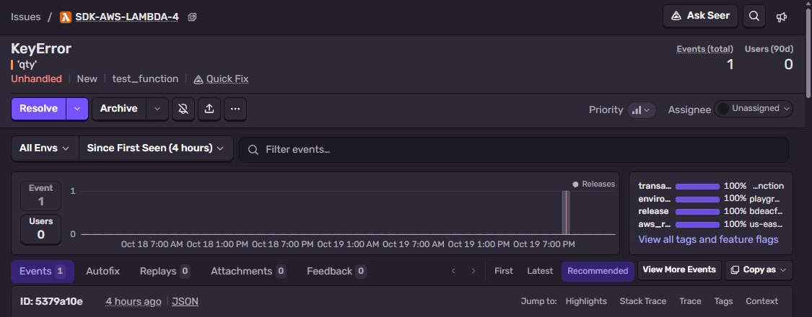
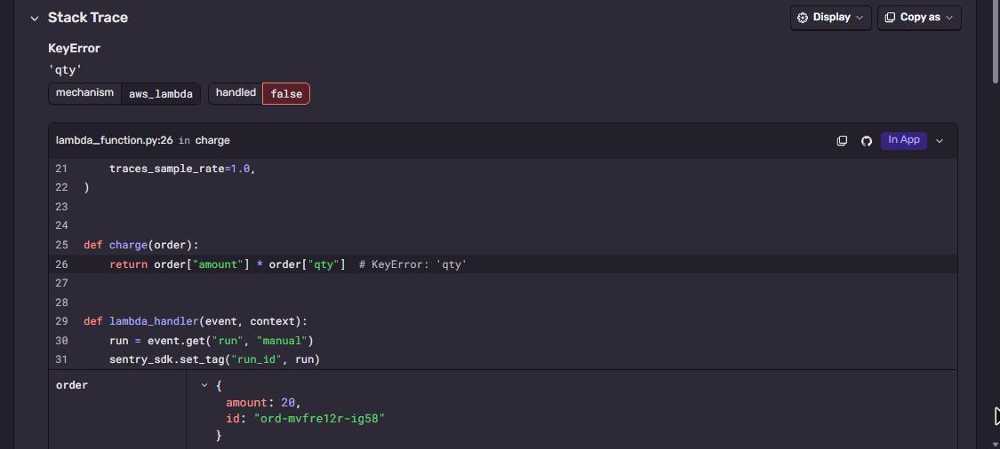
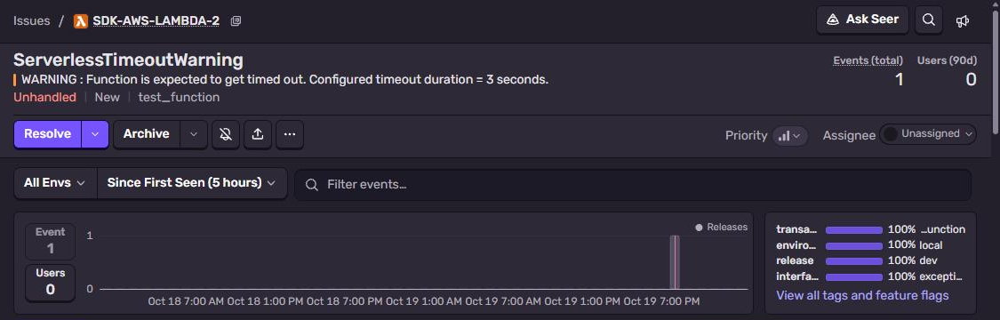

# Sentry + AWS Lambda (Python), no AWS account needed

Python Lambda function with `AwsLambdaIntegration`. It runs in the **official AWS Lambda base image**,
which includes the Runtime Interface Emulator, so you invoke it locally exactly like Lambda does.
Part of [Sentry Playground](https://github.com/fsmaster/sentry-playground).



## What you need

- Docker
- Sentry project with platform **AWS Lambda (Python)**

## 1. Get the DSN

Sentry → **Settings → Projects → (project) → Client Keys (DSN)**.

## 2. Build and start the "Lambda"

```bash
git clone https://github.com/fsmaster/sentry-sample-aws-lambda.git
cd sentry-sample-aws-lambda
docker build -t sentry-sample-aws-lambda .
docker run --rm -p 9000:8080 -e SENTRY_DSN="https://<key>@<org>.ingest.us.sentry.io/<project-id>" sentry-sample-aws-lambda
```

## 3. Invoke it

In other terminal:

```bash
curl -d '{"run":"test-1"}' localhost:9000/2015-03-31/functions/function/invocations
```

Answer is the Lambda error JSON (`KeyError: 'qty'`), same as real Lambda returns.

Timeout case. Function timeout is set to 3 s, the handler sleeps 10 s:

```bash
curl -d '{"run":"test-2","kind":"timeout"}' localhost:9000/2015-03-31/functions/function/invocations
```

## 4. Check it in Sentry

- `KeyError: 'qty'` with stack trace in `lambda_function.py`, and **aws_lambda** context: function
  name, request id, remaining time
- `ServerlessTimeoutWarning: WARNING : Function is expected to get timed out` arrives **before** the
  function is killed. Lambda kills the process on timeout, so without this warning you would get
  nothing at all





## How it works

```python
import sentry_sdk
from sentry_sdk.integrations.aws_lambda import AwsLambdaIntegration

sentry_sdk.init(
    dsn=os.environ.get("SENTRY_DSN"),
    integrations=[AwsLambdaIntegration(timeout_warning=True)],
    traces_sample_rate=1.0,
)
```

The integration wraps your handler: unhandled exceptions are reported and then re-raised (Lambda still
sees the failure), and it flushes before the handler returns. This flush is important, Lambda freezes
the process right after return.

`timeout_warning=True` starts a timer a bit before `context.get_remaining_time_in_millis()` runs out.

The invoke payload can have `"dsn"`, the playground sends it for **Use my DSN**. The handler then re-inits the
SDK with it. Fine in the emulator (one invoke at a time), on real AWS you would not do this.

## On real AWS

Same code, two ways:

1. **Layer, no code change.** Add Sentry's Lambda layer, set handler to
   `sentry_sdk.integrations.init_serverless_sdk.sentry_lambda_handler` and env vars `SENTRY_DSN`,
   `SENTRY_INITIAL_HANDLER=lambda_function.lambda_handler`.
2. **In the package.** `sentry-sdk` in `requirements.txt` and the `init` above. This sample does that,
   and the container image can be pushed to ECR and used as Lambda image as is.

## Troubleshooting

| Symptom | Why |
|---|---|
| Timeout warning doesn't come | Function timeout too small, the warning fires ~1.5 s before the end. |
| Errors locally but not on AWS | Lambda has no internet access (VPC without NAT). Sentry ingest must be reachable. |
